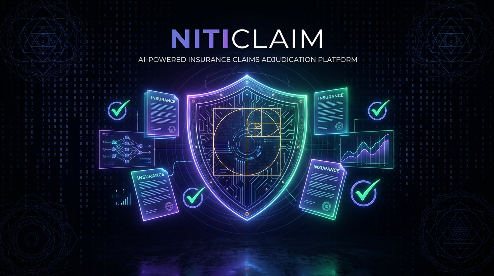
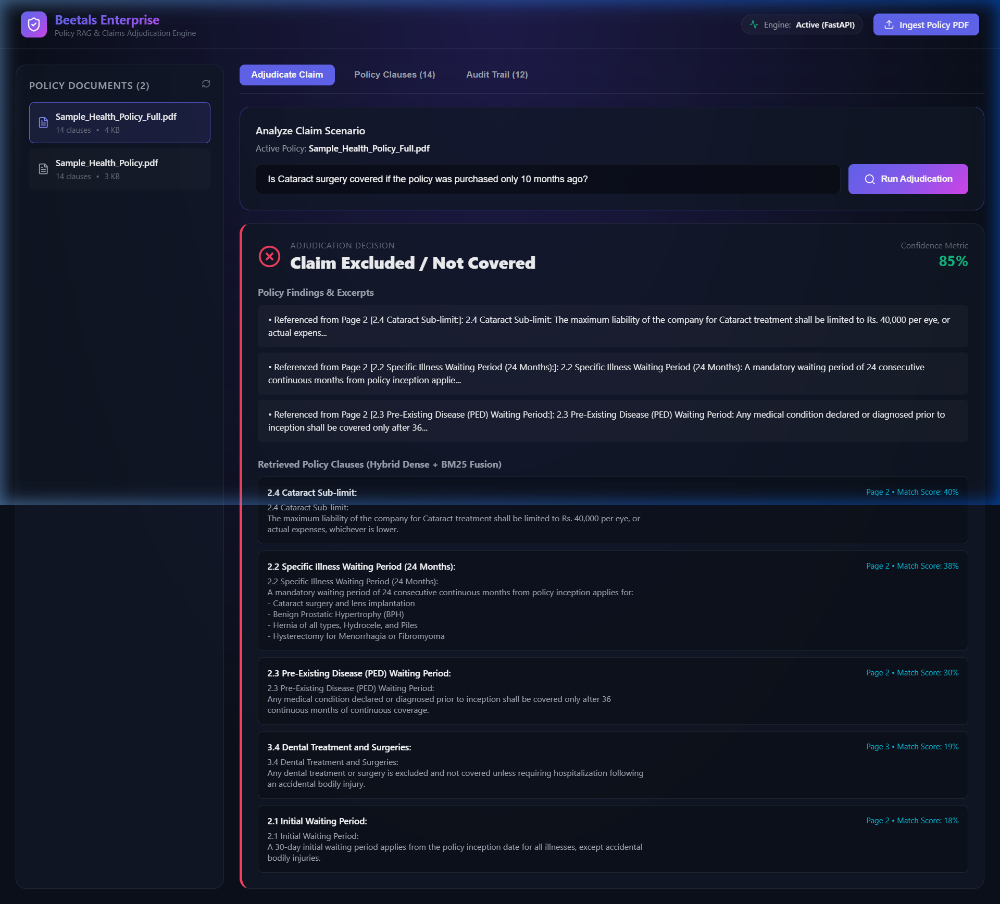
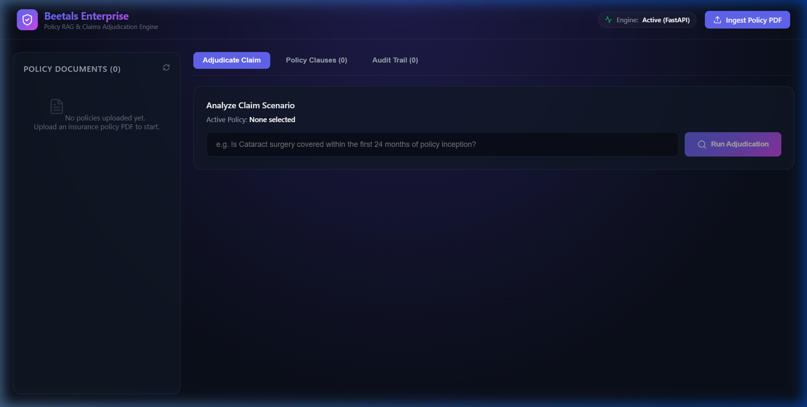
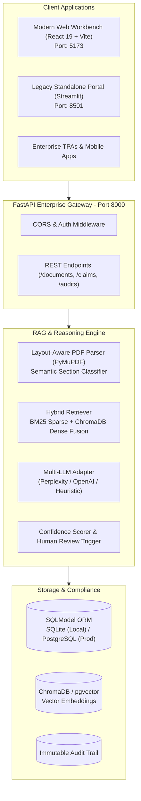

<div align="center">



# 🛡️ NitiClaim AI
### *Adjudication guided by policy truth.*

[](https://niticlaim.streamlit.app/)
[](https://fastapi.tiangolo.com)
[](https://react.dev)
[](https://vitejs.dev)
[](https://www.python.org/)
[](https://opensource.org/licenses/MIT)

*An enterprise-grade, retrieval-augmented intelligence platform that transforms dense insurance policy contracts into legally defensible, automated coverage decisions with cited clause verifications.*

🚀 **Live Deployment:** [niticlaim.streamlit.app](https://niticlaim.streamlit.app/)

[Live App](https://niticlaim.streamlit.app/) • [Explore Architecture](#-system-architecture) • [Live Workbench](#-live-workbench) • [Quick Start](#-quick-start) • [API Documentation](#-rest-api-reference)

---

</div>

## 📖 Etymology & Vision
**Niti (नीति)** is the Sanskrit and Hindi term representing **"Policy, Principles, Ethics, and Governance"**. Combined with **Claim**, **NitiClaim** embodies algorithmic justice: ensuring claim adjudication strictly reflects the true intent, waiting periods, sub-limits, and exclusions codified in insurance policy agreements.

---

## ⚡ Key Highlights & Capabilities

- 📄 **Layout-Aware PDF Ingestion**: Extracts complex, multi-column insurance policy PDFs with automatic semantic categorization (`Inclusions`, `Exclusions`, `Waiting Periods`, `Sub-Limits`, `General Conditions`).
- 🔍 **Hybrid Retrieval Engine (Dense + BM25 Fusion)**: Combines dense vector semantics with **BM25 lexical sparse retrieval** to eliminate hallucinations and pinpoint exact numerical clauses (e.g. *24-month waiting periods*, *Rs. 40,000 sub-limits*).
- ⚖️ **Confidence Scoring & Underwriter Flags**: Computes an automated confidence percentage (0–100%) and proactively flags borderline or ambiguous claims for human underwriter review.
- 🏛️ **Decoupled Architecture**: High-throughput **FastAPI asynchronous backend** with OpenAPI/Swagger docs paired with a modern dark-mode **React 19 / Vite** workbench.
- 📊 **Compliance & Legal Audit Trail**: Full relational audit logs (`SQLModel` / `SQLAlchemy 2.0`) capturing every query, model provider, matched clauses, and timestamped determinations.
- 🔄 **Multi-LLM Provider Adaptability**: Native connectors for Perplexity (`sonar-pro`), OpenAI (`gpt-4o`), and offline deterministic heuristic engines.

---

## 🖥️ Live Workbench

### 1. Interactive Claims Evaluation Workbench
Experience real-time PDF ingestion, clause browsing, and instant coverage determinations.



### 2. High-Tech Dark Mode Interface
Built for underwriters, claims adjusters, and third-party administrators (TPAs).



---

## 🏗️ System Architecture



---

## 🚀 Quick Start

### Prerequisites
- Python 3.11+
- Node.js 18+ and npm

### 1. Clone Repository & Setup Backend
```bash
git clone https://github.com/your-username/NitiClaim.git
cd NitiClaim

# Create and activate virtual environment
python -m venv venv
source venv/bin/activate  # On Windows: venv\Scripts\activate

# Install dependencies
pip install -r requirements.txt
pip install fastapi uvicorn pydantic-settings sqlmodel rank-bm25 pytest httpx python-multipart pymupdf
```

### 2. Configure Environment (Optional)
Create a `.env` file in the root directory:
```env
APP_NAME="NitiClaim Enterprise Engine"
DATABASE_URL="sqlite:///./insurance_claims.db"
DEFAULT_LLM_PROVIDER="perplexity"
PERPLEXITY_API_KEY="your-api-key-here"
OPENAI_API_KEY="your-openai-key-here"
```

### 3. Launch the Backend API Server
```bash
python -m uvicorn api:app --reload --host 0.0.0.0 --port 8000
```
- API Documentation (Swagger): [http://localhost:8000/docs](http://localhost:8000/docs)
- Health Check: [http://localhost:8000/api/v1/health](http://localhost:8000/api/v1/health)

### 4. Launch the Modern React UI
In a separate terminal:
```bash
cd frontend
npm install
npm run dev
```
Open [http://localhost:5173](http://localhost:5173) in your browser.

### 5. (Alternative) Launch Streamlit Portal
```bash
streamlit run app.py
```
Open [http://localhost:8501](http://localhost:8501).

---

## 🧪 Automated Testing

NitiClaim includes a rigorous automated test suite testing PDF parsing, BM25 rank fusion, JSON sanitization, and end-to-end API flows:

```bash
python -m pytest tests/test_enterprise.py -v
```

Expected Output:
```
tests/test_enterprise.py::test_semantic_section_detection PASSED         [ 20%]
tests/test_enterprise.py::test_hybrid_retriever_bm25_ranking PASSED      [ 40%]
tests/test_enterprise.py::test_llm_json_cleaner PASSED                   [ 60%]
tests/test_enterprise.py::test_health_check_endpoint PASSED              [ 80%]
tests/test_enterprise.py::test_document_and_claim_flow PASSED            [100%]

======================== 5 passed in 2.13s ========================
```

---

## 📡 REST API Reference

| Method | Endpoint | Description |
|:---|:---|:---|
| `GET` | `/api/v1/health` | Service health and telemetry status |
| `POST` | `/api/v1/documents/upload` | Multipart upload, layout parsing, and hybrid indexing |
| `GET` | `/api/v1/documents` | Retrieve all indexed policy documents |
| `GET` | `/api/v1/documents/{id}/clauses`| Inspect all parsed clauses & section tags for a policy |
| `POST` | `/api/v1/claims/analyze` | Run claim adjudication with hybrid RAG + LLM |
| `GET` | `/api/v1/claims/audits` | Query compliance audit logs and history |

---

## 🗺️ Future Roadmap & Suggested Enhancements

- [ ] **OCR Engine for Scanned Policies**: Integrate `Tesseract` or AWS Textract for scanned legacy physical contracts.
- [ ] **Table Understanding**: Dedicated multi-column tabular parser for complex hospital room rent tiers and surgical procedure schedules.
- [ ] **Multi-Tenant RBAC**: Organization-level isolation for different insurance underwriters, brokers, and TPAs.
- [ ] **FHIR / HL7 Integration**: Direct medical bill data ingestion from hospital electronic health record systems.

---

## 📄 License
This project is licensed under the MIT License - see the LICENSE file for details.
